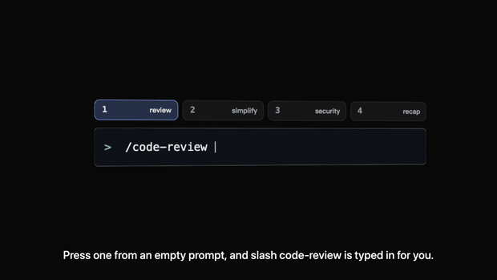

# quick-keys

**简体中文** · [English](README.md)

一个 Claude Code mod，在输入框上方画一排数字键快捷方式。从空输入框按 `1`，
`/code-review ` 就替你打好了；按绑定到 `submit` 的那个键，它会自己把一整轮发出去。
这些快捷方式都可以改：`/keys` 会打开一个面板，在里面增删、改写、翻转每一项，
改完的内容跨会话保留。

[](https://github.com/ktang85/quick-keys/blob/main/docs/intro-zh.mp4)

> 上面是 4 秒无声预览。点它看完整视频（29 秒，带旁白与字幕），或[下载文件](https://github.com/ktang85/quick-keys/raw/main/docs/intro-zh.mp4)。

自带四个，就是让你替换的：

| 键 | 标签 | 类型 | 做什么 |
| --- | -------- | ------ | -------------------------------------------------- |
| `1` | review   | fill   | 把 `/code-review ` 打进输入框 |
| `2` | simplify | fill   | 打 `/simplify ` |
| `3` | security | fill   | 打 `/security-review ` |
| `4` | recap    | submit | 发送「Recap what you changed so far in this session, file by file.」 |

`fill` 把文字放进输入框、光标留在那里，所以你可以先补一个路径或一句话再发。
`submit` 直接作为一轮发出去，不需要确认 —— 这个留给那些你总是整条发的提示词。

Claude 正在干活时、以及有问卷弹出时，这排键会自己隐藏，所以它不会压在别的东西上面。

## 安装

在终端会话的输入框里：

```
/plugin install quick-keys --marketplace ktang85/quick-keys
```

从 shell：

```
claude plugin install quick-keys --marketplace ktang85/quick-keys
```

回答 `y` 添加 marketplace，然后选一个作用域（选 user 作用域会对所有项目生效）。
在桌面应用里 `/plugin` 跑不了：点输入框旁边的 +，然后 Plugins，
用 `ktang85/quick-keys` 添加 marketplace，再 Add plugin。

## 改快捷方式

运行 `/keys`。每一行有数字、标签、一个翻转类型的 `fill`/`submit` 按钮、文本、
以及 `remove`。`add` 输入框接受一行：

```
<数字> <fill|submit> <标签> <文本>
```

所以 `5 fill tests /react-test` 会把 `5` 绑定到一个标签为 `tests` 的按钮上，
按下它会把 `/react-test` 打进输入框。已被占用的数字会被替换而不是重复添加，
解析不了的一行会以 toast 的形式拒掉而不是存进去。`reset` 把那四个默认项放回来。

这些条目存在插件自己的 store 里，按机器区分，不是一个你手工编辑的文件。

## 开发

```
claude --plugin-dir /path/to/quick-keys      # 带着这个 mod 跑一个会话
claude plugin validate /path/to/quick-keys   # manifest、state 契约、hooks
claude plugin test /path/to/quick-keys       # tests/ 里的 8 个测试
```

`claude plugin test` 必须在 Claude Code 会话之外跑 —— 会话自己的环境会让它拒绝执行。

引擎第一次加载这个 mod 时会写出 `.claude-plugin/types/`：API 声明，以及顶层
`tsconfig.json` 所继承的那个 tsconfig。那个目录是生成的、也被 gitignore 了，
所以 `tsc -p .` 只有在加载过一次之后才能用。

- `hooks/register.tsx` —— 整个 mod：`session.start`、`command.run`，以及两个
  `ui.render` hook（那排键、那个面板）。
- `types/index.d.ts` —— `$.state` 契约，`claude plugin validate` 会拿它来约束模块。
- `tests/band.test.tsx` —— 挂载那排键和那个面板并驱动它们。

## 许可

MIT。见 [LICENSE](LICENSE)。
